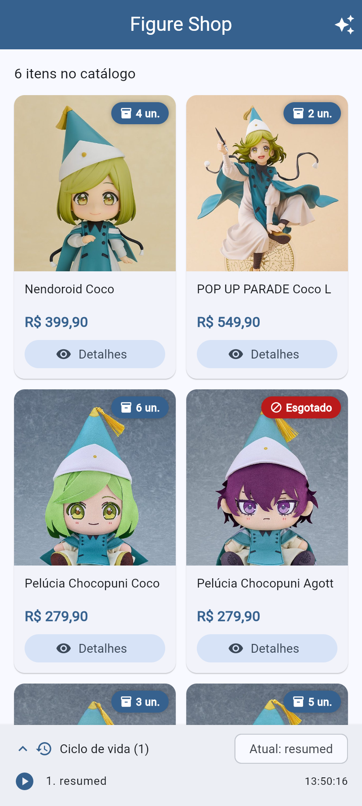
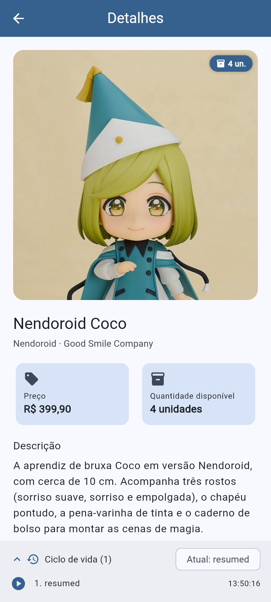
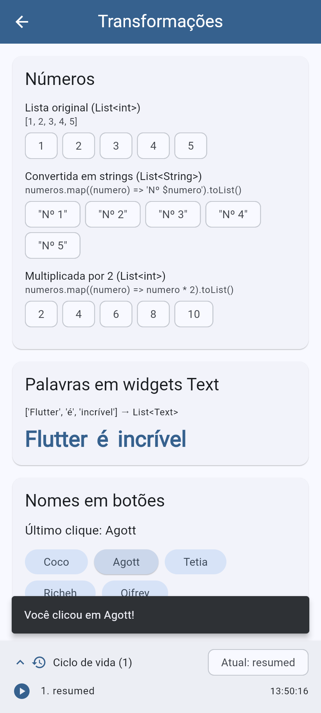

# Figure Shop

Catálogo de figures e pelúcias de **Witch Hat Atelier** (Tongari Bōshi no Atelier) em Flutter, feito para a atividade **N2 - E2** da disciplina de desenvolvimento mobile.

## Funcionalidades

- **Catálogo:** cards gerados com `map()` e `toList()` a partir de uma lista de `Produto`. Cada card usa um `Stack` para sobrepor o indicador de quantidade à foto do produto.
- **Detalhes:** a tela abre com `Navigator.push()`, recebe o objeto `Produto` pelo construtor e volta com `Navigator.pop()`.
- **Transformações:** listas de números convertidas em strings e multiplicadas por 2, palavras transformadas em widgets `Text` e nomes transformados em botões, tudo com `map()` e `toList()`.
- **Ciclo de vida:** `AppLifecycleListener` registra os estados do app num histórico que aparece no rodapé de todas as telas.

## Estrutura

```
lib/
├── main.dart                         # cria o registro de ciclo de vida e inicia o app
├── app.dart                          # MaterialApp e tema
├── models/produto.dart               # classe Produto
├── data/produtos_iniciais.dart       # lista fixa de produtos
├── services/registro_ciclo_vida.dart # AppLifecycleListener + histórico
├── utils/formatacao.dart             # preço em R$ e horário
├── widgets/imagem_produto.dart       # foto com limites min/max + Stack com indicador
├── widgets/produto_card.dart         # card do catálogo
├── widgets/painel_ciclo_vida.dart    # painel do histórico
└── screens/
    ├── catalogo_screen.dart
    ├── detalhes_screen.dart
    └── transformacoes_screen.dart
```

## Como executar

```bash
flutter pub get
flutter run
```

Para observar o ciclo de vida completo (`inactive`, `hidden`, `paused`), rode em um dispositivo ou emulador Android e use o botão Início.

Feito com Flutter 3.47 e Dart 3.13.

## Telas

| Catálogo | Detalhes | Transformações |
|---|---|---|
|  |  |  |

## Créditos das imagens

As fotos dos produtos são imagens oficiais de divulgação da [Good Smile Company](https://www.goodsmile.com/en/witch_hat_atelier), usadas apenas para fins educacionais neste projeto acadêmico:

- [Nendoroid Coco](https://www.goodsmile.com/en/product/1137456/Nendoroid+Coco)
- [POP UP PARADE Coco L Size](https://www.goodsmile.com/en/product/1139089/POP+UP+PARADE+Coco+L+Size)
- [Chocopuni Plushie Coco / Agott / Tetia / Richeh](https://www.goodsmile.com/en/product/1141447/Chocopuni+Plushie+Coco+Agott+Tetia+Richeh)

*Witch Hat Atelier* © Kamome Shirahama / Kodansha. Preços em reais e estoques são fictícios.
